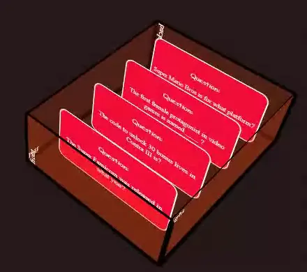

# Cue Card

Cue Card is a 2019 flashcard prototype built around a 3D shoebox. Try to recall an answer, flip the card, then decide whether it should leave the quiz or come back for another try. The project takes inspiration from Nicky Case’s interactive explanation of active recall and the Leitner system. [How To Remember Anything Forever-ish](https://ncase.me/remember/).

**[Try Cue Card live](https://nastajus.github.io/ng-cue-card/)** · Runs in your browser with a sample deck.

## Demos

### Recall session


The quiz cycles through all three seeded cards. A **nah** sends the first card back for another try, and **yup** advances through the rest to the completion screen. One seed card starts without an answer.

### Card selector and editor

The editor corrects a console name, removes two entries, and adds questions about Luigi and Link. The last view shows the updated list and its debug array.

### Pointer-reactive shoebox



A slow pass shows each card lift and change colour. Quick passes show how the stack responds as the pointer moves away and back.

The [original quiz recording](docs/images/demos/cc1.gif) and [original shoebox recording](docs/images/demos/cc2.gif) are from the [portfolio archive](https://nastajus.github.io/archive/portfolio/index.html#cc).

## What’s in the prototype

- **Flashcard collection.** Add, edit and delete in-memory cards. The form allows a question, an answer or both.
- **Recall quiz.** Flip a seeded card and mark it remembered or missed. Remembered cards leave the current session and missed cards can return. Separate card instances allow the outgoing and incoming cards to overlap during a slide.
- **3D shoebox.** CSS transforms assemble the box. The component calculates card slots from shared SCSS dimensions. The shoebox rebalances when cards are added or removed. Move the pointer near the cards to lift them and shift their colours.
- **Study model.** A sample topic and card subset feed the quiz. Persistent decks, saved review history and scheduled Leitner progression are unfinished.

The prototype was designed for desktop Chrome. The original roadmap called for local storage and full Leitner scheduling, with mobile and offline study, rich card content and Anki exchange as later ideas. [Historical roadmap](https://nastajus.github.io/archive/portfolio/cue-card.html).

## Known issue

A thin horizontal line has been reported on some card faces in Firefox since the November 2026 flip repair. The latest build removes an extra front-face transform as a trial. The issue remains open pending confirmation in the affected Firefox session. The [shoebox postmortem](docs/shoebox-postmortem.md#follow-up--new-firefox-card-face-seam) includes the cropped screenshot and test results.

## How it works

The Angular 7 application uses an RxJS service to publish the collection and selected card. The quiz creates and removes card views as transitions complete. A build step exports SCSS dimensions to TypeScript so the CSS box and the positioning math use the same values.

## Engineering notes

Start with [Engineering notes from Cue Card](docs/LEARNING.md) for the lessons, code examples, and diagrams behind the prototype. The [2019 journal](docs/archive/development-journal-2019.md) preserves the original “References used” section, and the [reference index](docs/archive/reference-index.md) points to selected sources by topic.

## Development

The project uses Angular 7.2, Angular CLI 7.3 and RxJS 6.3. Use a period-compatible local environment, for example Node 10 with npm 6. The build also needs Bash and `sed`. On Windows, point npm’s `script-shell` at your Git for Windows `bash.exe`. [Angular version compatibility](https://angular.dev/reference/versions#before-v9), [npm script shell](https://docs.npmjs.com/cli/v6/commands/npm-run-script/).

```bash
npm ci
npm start       # http://localhost:4200/
npm run build   # dist/
npm test        # Karma
```

Restart the dev server after editing shared SCSS dimensions to regenerate the TypeScript module. See the [original setup notes](docs/archive/setup-2019.md) for historical troubleshooting.
