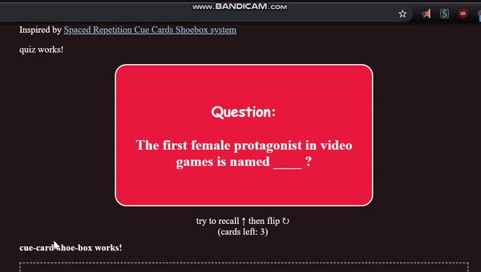
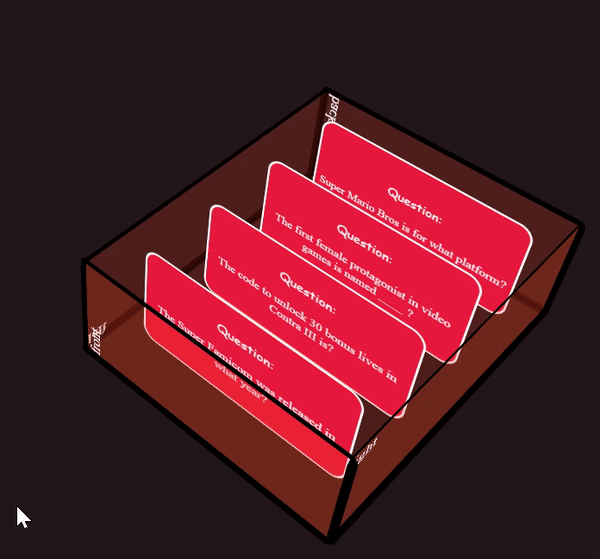

# Cue Card

Cue Card is a 2019 flashcard prototype built around a 3D shoebox. Try to recall an answer, flip the card, then decide whether it should leave the quiz or come back for another try. The project takes inspiration from Nicky Case’s interactive explanation of active recall and the Leitner system. [How To Remember Anything Forever-ish](https://ncase.me/remember/).

**[Try Cue Card live](https://nastajus.github.io/ng-cue-card/)** · Runs in your browser with a sample deck.

## Demos



*Flip to reveal the answer. A successful recall slides the card out and brings the next question forward.*



*Move the pointer across the shoebox. Nearby cards rise and change colour in this historical build.*

Both recordings come from the [original portfolio entry](https://nastajus.github.io/archive/portfolio/index.html#cc).

## What’s in the prototype

- **Flashcard collection.** Add, edit and delete in-memory cards. The form allows a question, an answer or both.
- **Recall quiz.** Flip a seeded card and mark it remembered or missed. Remembered cards leave the current session and missed cards can return. Separate card instances allow the outgoing and incoming cards to overlap during a slide.
- **3D shoebox.** CSS transforms assemble the box. The component calculates card slots from shared SCSS dimensions. The current source has a known timing problem when rebalancing after collection changes. The pointer effect shown above is disabled in this checkout.
- **Study model.** A sample topic and card subset feed the quiz. Persistent decks, saved review history and scheduled Leitner progression are unfinished.

The prototype was designed for desktop Chrome. The original roadmap called for local storage and full Leitner scheduling, with mobile and offline study, rich card content and Anki exchange as later ideas. [Historical roadmap](https://nastajus.github.io/archive/portfolio/cue-card.html).

## How it works

The Angular 7 application uses an RxJS service to publish the collection and selected card. The quiz creates and removes card views as transitions complete. A build step exports SCSS dimensions to TypeScript so the CSS box and the positioning math use the same values.

## Engineering notes

Start with [Engineering notes from Cue Card](docs/LEARNING.md) for the lessons, code examples, and diagrams behind the prototype. The [2019 journal](docs/archive/development-journal-2019.md) preserves the original “References used” section, and the [reference index](docs/archive/reference-index.md) points to selected sources by topic.

## Development

The project uses Angular 7.2, Angular CLI 7.3 and RxJS 6.3. Use a period-compatible local environment, for example Node 10 with npm 6. The build also needs Bash and `sed`. On Windows, point npm’s `script-shell` at your Git for Windows `bash.exe`. [Angular version compatibility](https://angular.dev/reference/versions#before-v9), [npm script shell](https://docs.npmjs.com/cli/v6/commands/npm-run-script/).

```bash
npm ci
npm start       # http://localhost:4200/
npm run build   # dist/
npm test        # Karma
```

Restart the dev server after editing shared SCSS dimensions to regenerate the TypeScript module. See the [original setup notes](docs/archive/setup-2019.md) for historical troubleshooting.
