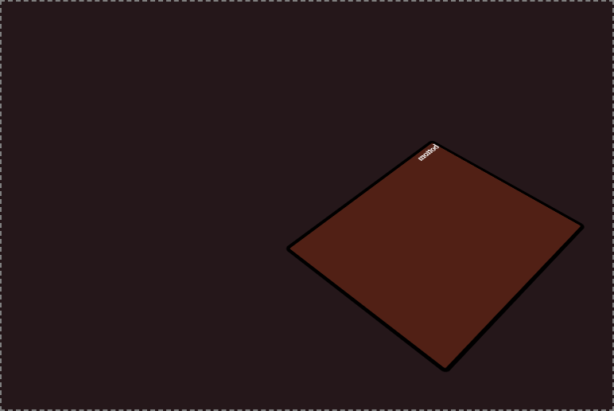
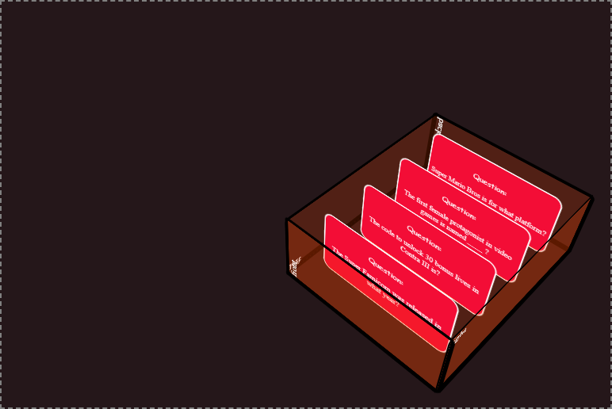

# Engineering notes from Cue Card

[Back to the Cue Card README](../README.md) · [Try the live prototype](https://nastajus.github.io/ng-cue-card/)

Cue Card started as a flashcard prototype and became a hands-on study of how a UI turns changes in data into changes on screen. The original README follows those discoveries in real time, including searches, wrong turns, decisions and ideas for the product. Start here when you want to revisit a concept. Go to the journal when you want to see how the thinking changed.

- [Development journal](archive/development-journal-2019.md) preserves the complete “References used” section and recovered passages on export, study workflow and D3.
- [Reference index](archive/reference-index.md) gives a short route back to sources worth revisiting.
- [Shoebox postmortem](#postmortem--why-the-shoebox-went-flat) traces the regression and compares the historical and current code.

## Research threads

| Investigation | What it turned into | Journal |
| --- | --- | --- |
| Centering and spacing in 3D | Shared geometry between SCSS and TypeScript, with a build step to carry values across | [Centering and SCSS export](archive/development-journal-2019.md?plain=1#L55) |
| Mouse reactivity and UI polish | State selection, pointer geometry, colour feedback, form rules and responsive layout | [Mouse interaction and UI polish](archive/development-journal-2019.md?plain=1#L104) |
| Rebalance fired too early | Separate the data signal from the view-query signal | [Rebalance and teardown](archive/development-journal-2019.md?plain=1#L278) |
| “Designing model good” | Separate identity from state and decide who owns a change across study topics, sessions and history | [Model design](archive/development-journal-2019.md?plain=1#L436) |
| Quiz animation and overlap | Give outgoing and incoming cards separate lifetimes and place animation on the moving host | [Single-instance breakthrough](archive/development-journal-2019.md?plain=1#L926), [host experiment](archive/development-journal-2019.md?plain=1#L1400) |
| Late rebalancing regression | Revisit assumptions when a later refactor changes the point at which code runs | [Later investigation](archive/development-journal-2019.md?plain=1#L1417) |
| Tooling and return after a break | Recover the build assumptions, try the library in isolation and capture the setup steps | [Dependency investigation](archive/development-journal-2019.md?plain=1#L140), [D3 branch notes](archive/development-journal-2019.md#supplement--returning-to-the-project-and-exploring-d3) |
| Offline study and file export | Product scope and ownership questions framed as user stories | [Offline spike](archive/development-journal-2019.md?plain=1#L395), [recovered user stories](archive/development-journal-2019.md#supplement--file-export-and-the-study-workflow) |

## Lessons

1. [Domain modelling and state ownership](lessons/state-management.md). Which card is this across edits, quiz attempts and reloads?
2. [Reactive programming](lessons/reactive-programming.md). Who can publish changes, and when do subscriptions end?
3. [Angular views and component identity](lessons/component-lifecycle.md). How do you tell when the element you need exists?
4. [Quiz animation and layering](lessons/animation-architecture.md). Who owns motion, sequencing and cleanup?
5. [Shoebox geometry and visual feedback](lessons/css-geometry.md). How do dimensions, transforms and pointer distance fit together?
6. [JavaScript and TypeScript](lessons/javascript-typescript.md). What actually happens at runtime when you pass, cast or map an object?
7. [Build tooling and reproducibility](lessons/build-tooling.md). What does a clean checkout need to generate the same geometry?
8. [UI and product design](lessons/ui-design.md). Where does the physical metaphor help, and what belongs in the first release?
9. [Engineering methodology](lessons/engineering-methodology.md). When is it time to stop trying recipes and learn the governing rules?

The code links describe the source checkout used for this review. Historical links identify the relevant earlier implementation. Angular examples use the project’s Angular 7 and RxJS 6 conventions.

## Postmortem — Why the shoebox went flat

The 2019 work had already solved much of the hard part. The card slot math worked, and the April rebalancing fix had found the right Angular lifecycle signal. When the project was revisited with AI assistance in November 2026, Git and the journal supplied the two clues needed to recover it. One was about **when the card hosts exist**. The other was about **whether CSS lets those hosts and the box walls share depth**. The two failures can be reproduced independently.

### Timeline and cost

| Date | What the record shows |
| --- | --- |
| April 14–21, 2019 | The shoebox went from basic faces and an isometric view to a single aligned card, shared SCSS dimensions, and a spaced stack. The April 19 refactor also introduced separate `#faces` and `#cards` wrappers. The test cube was an attempt to isolate the transforms from the full scene. [Isometric view](https://github.com/nastajus/ng-cue-card/commit/9504776) · [Wrappers and SCSS export](https://github.com/nastajus/ng-cue-card/commit/79c679d) · [Test cube](https://github.com/nastajus/ng-cue-card/commit/85cc2bf) · [Spaced stack](https://github.com/nastajus/ng-cue-card/commit/b068d62) |
| April 25 | The journal recorded `rebalance` running too early and explored OnPush, manual detection, `trackBy`, the async pipe, view queries and subscription teardown. The committed fix positioned the initial cards in `ngAfterViewInit` and used `this.cc.changes` for later changes. The same section records the successful add flow. [Journal investigation](archive/development-journal-2019.md?plain=1#L278) · [Rebalance fix](https://github.com/nastajus/ng-cue-card/commit/3bc2237) |
| April 26 | About **24 hours after the fix**, the getter-to-observable refactor replaced the live view-query subscription with `cueCards$.subscribe(...)`. The template already knew how to display emitted cards. The new subscriber assumed the emitted list and the rendered list were ready at the same time. [Regression diff](https://github.com/nastajus/ng-cue-card/commit/2eb7cca) |
| May 21 | **25 days and 26 descendant commits later**, the journal explicitly rediscovered that the callback was firing before the view refreshed. The notes mention dynamic quiz components and element IDs as hypotheses, then record a breakpoint confirming that the element existed by `ngAfterViewChecked`. The commit added a debug hook and left the data subscription in place. Many intervening commits concern quiz animation and overlap. [Second investigation](archive/development-journal-2019.md?plain=1#L1417) · [May 21 diff](https://github.com/nastajus/ng-cue-card/commit/d4581f8) |
| October 4 | The revert and the addition of the checked-in build left the early subscription and the flat wrappers in the historical snapshot. [Revert](https://github.com/nastajus/ng-cue-card/commit/660a88f) · [Archived build](https://github.com/nastajus/ng-cue-card/commit/6c09c40) |
| November 26, 2026 | The AI-assisted patch restored the view-query trigger, made the queried elements the direct targets, and added one CSS rule for both wrappers. The published build was checked in the browser. [Patch diff](https://github.com/nastajus/ng-cue-card/commit/d1885c7) |

There are **31 descendant commits** from the April 25 fix through the October 4 snapshot, and **five commits touching the shoebox directory** in that range, including cleanup and the revert. These counts describe the history surrounding the regression. The journal gives direct evidence of two rounds of debugging, but it cannot establish hours spent, how many experiments went uncommitted, or how many commits were lost to the bug. It also cannot date when the flat rendering first became visible on the original browser. The wrappers were already present when the April commit reported working spacing, and the archived demo shows a visible stack.

To reproduce the counts from the source checkout:

```bash
git rev-list --count --ancestry-path 3bc2237..6c09c40
git rev-list --count 3bc2237..6c09c40 -- src/app/components/cue-card-shoe-box
git rev-list --count --ancestry-path 2eb7cca..d4581f8
```

### Failure 1 — A new array entry is ahead of its element

The April 26 code looked reasonable because the list was reactive and the subscription was established in `ngAfterViewInit`. Here is the active part of that revision:

```ts
this.ccLoaderService.cueCards$.subscribe(
  (cueCards: CueCard[]) => {
    this.rebalanceBoxCardPositions(cueCards);
  }
);
```

`ngAfterViewInit` establishes that the initial children exist when the subscription is made. Later emissions trigger their own callback. On an add, the service already has five items and the async pipe has received the change, but Angular can still have four rendered hosts while the callback is running. The old loop looked up `bcc4` by document ID before the fifth host was ready. In the archived build, all four original hosts received updated offsets during the add, and the new host subsequently appeared with **no inline transform**. It fell back to the same hard-coded CSS offset used for any unpositioned card.

The 2026 patch restores the April 25 structure. It keeps the observable in the template and uses the rendered query for layout. This excerpt is from the [current shoebox](../src/app/components/cue-card-shoe-box/cue-card-shoe-box.component.ts):

```ts
@ViewChildren('cc', { read: ElementRef }) cc: QueryList<ElementRef<HTMLElement>>;
private _cardChanges: Subscription;

ngAfterViewInit() {
  this.rebalanceBoxCardPositions();
  this._cardChanges = this.cc.changes.subscribe(() => this.rebalanceBoxCardPositions());
}

ngOnDestroy() {
  this._cardChanges.unsubscribe();
}
```

The loop now gets its count and target from the same query. The original `boxLength / count * (i + 1)` spacing and SCSS-derived offsets are still there. The write targets `card.nativeElement.style.transform` rather than replacing the entire style attribute of a document-wide ID. The ID remains available to the card component. There is no timeout, repeated after-check polling, change detection strategy change, or geometry rewrite. The focused check is four initial offsets, five distinct offsets immediately after adding, then the original four after deletion.

### Failure 2 — A 3D transform can still be flattened by a parent

The box already had a valid perspective on `.scene` and `transform-style: preserve-3d` on `.box`. Its children, however, were the plain block wrappers `#faces` and `#cards`. The actual walls and card hosts were one level below those wrappers. `transform-style` does not inherit. Each wrapper must carry the 3D context through to its children. Otherwise the browser flattens its descendants into the wrapper plane before compositing that plane in the outer scene. Accurate card depths in the DOM are compatible with an image that still looks flat. [CSS Transforms Level 2](https://www.w3.org/TR/css-transforms-2/#3d-rendering-contexts)

The complete shoebox CSS addition was:

```scss
#faces, #cards {
  transform-style: preserve-3d;
}
```

This keeps the existing wrappers, transforms and angle. In Edge and Firefox, temporarily setting only those wrappers back to `flat` on the fixed build reproduced the flat panel with the cards missing from view. Removing the temporary override immediately restored the visible walls and cards. The two captures below use the same build and card coordinates.

| Wrapper depth disabled by a temporary CSS override | Wrapper depth preserved |
| --- | --- |
|  |  |

### What made the bug hard to isolate

The visual result hid the state of the input. A flat panel could look the same whether a card had a valid depth or never received one. In the original investigation, a data emission, a view update, and the final paint were easy to treat as one event. The useful split was to check them in order:

1. Count the service items and the rendered hosts at the moment the collection changes.
2. Inspect the inline transforms. If the count matches and every card has a distinct depth, hold the geometry constant.
3. Toggle only the parent wrappers' `transform-style`. If the cards reappear without their transforms changing, the remaining failure is in the CSS rendering context.

The journal already supplied the initial timing diagnosis and the idea of isolating geometry in a test cube. Git exposed the exact refactor that crossed the timing boundary. AI assistance helped compare those revisions and run the wrapper test with the other variables held constant.

### Separate follow-up — A one-pixel line across some card faces

The later screenshot shows a single darker row of red across the question face, surrounded by rows of normal red. There is no corresponding divider in the card markup. A browser compositing seam is plausible because the flip patch introduced a front-face `translateZ(1px)` and a separate depth for the back face. That adds a candidate to test, but the screenshot alone does not identify the cause. I did not reproduce the seam in headless Edge or Firefox at tested device scales from 1× to 2×, including approximately 1.83×, or in the additional page-zoom trials.

A temporary override that disabled the front-face offset still showed a clean answer in Edge. The line was already absent in that run, so it did not test the candidate against the reported symptom. The narrow next experiment is to disable **only** the front face's `translateZ(1px)` in the affected browser while the line is visible. Leave the back face at `rotateY(180deg) translateZ(1px)` so the faces are still separated, then check whether the line disappears and whether both faces remain clean through a flip in each direction. Until that comparison reproduces the difference, the published flip CSS stays as it is.
