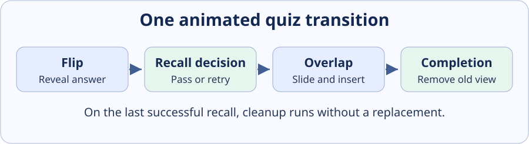
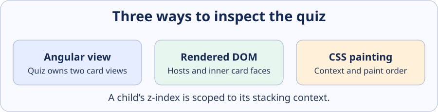

# Quiz animation and layering

The early quiz fed a new model into the same card component. The author expected an exit animation when the previous card went away, but the component stayed mounted and received new input. Using two instances made it possible to retain the old card while introducing the next one. [Original realization](../archive/development-journal-2019.md?plain=1#L926), [dynamic component experiment](https://github.com/nastajus/ng-cue-card/commit/05cadeb).

## Let each card move, and let the quiz decide what happens next

At this revision the [quiz](../../src/app/components/quiz/quiz.component.ts) resolves a `CueCardComponent` factory, creates a view through a `ViewContainerRef`, sets its data, subscribes to its outputs and keeps the reference. On recall it sets `hasRecalled` on the first instance and creates the next instance, if any. On a miss it marks the current card for another attempt and selects a replacement. The [card](../../src/app/components/cue-card/cue-card.component.ts) owns the flip and slide transitions. The quiz owns queue advancement and removal, using the card’s completion output.



Representative checkout code from the recall path:

```ts
this._components[0].instance.hasRecalled = true;
this.addComponent(this.quizzingCards.slice(-1)[0]); //gets last element.
```

The outgoing instance remains present as its animation runs. Completion promotes the second card to the front and removes the first view. The last successful recall takes a separate cleanup path without inserting a replacement. Rapid repeated input is a known gap in the source. Explicit phases such as “question,” “revealed,” “transitioning” and “finished” could make accepted events and cleanup easier to reason about.

## Bind to the element that actually moves

An animation state describes a resting style and a transition describes motion between states. In Angular 7, `:enter` and `:leave` are aliases for transitions from or to `void`, where the animation engine sees the relevant insertion or removal. Cue Card’s final slide instead changes a mounted card’s state and waits for completion before it removes the view. A host binding attaches a trigger to the component’s host element. A host listener can handle completion there. A template anchor provides a place to create views, while each instantiated host is a real element that can move. Angular’s parent animation can coordinate nested triggers with `query` and `animateChild` when a nested animation actually needs that sequencing.



The overlapping cards use absolute positioning, which takes them out of normal flow. The quiz wrapper reserves vertical space. Inspect the nearest ancestor that establishes the containing block to explain where each absolutely positioned host lands. A stacking context groups elements for painting. A transformed element can establish one, and a high child `z-index` cannot escape its group to paint over an unrelated group. Inspect the rendered ancestors and their computed styles when a slide appears above the incoming card unexpectedly. The [overlap commit](https://github.com/nastajus/ng-cue-card/commit/d092d26) and [host-animation commit](https://github.com/nastajus/ng-cue-card/commit/258ff64) show the movement of this logic. The journal also records a double-removal incident when both styles of completion callback were active. [Host experiment and duplicate callback](../archive/development-journal-2019.md?plain=1#L1400).

[Angular 7 animations guide source](https://github.com/angular/angular/blob/7.2.16/aio/content/guide/animations.md) · [Learning index](../LEARNING.md)
