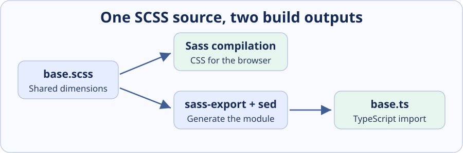

# Build tooling and reproducibility

The shoebox needed the same dimensions as the stylesheet. Putting them in SCSS solved ownership, and a generator let TypeScript read the compiled values. The first pipeline worked on the author’s computer because the Sass exporter was installed globally. Another checkout lacked that executable. The fix put the exporter into the project’s development dependencies. [Centering and missing dependency notes](../archive/development-journal-2019.md?plain=1#L55), [dependency fix](https://github.com/nastajus/ng-cue-card/commit/cc9d429).

## Follow the build from input to consumer

The [package scripts](../../package.json) run `sass-export` on [base.scss](../../src/styles/base.scss), then run the `json2module` script to prepend `export default` via `sed`. The [generated module](../../src/app/generated/styles/base.ts) gives the shoebox and quiz access to compiled values via a TypeScript import. The module is produced at build time. Its values are read at runtime, after bundling.

- npm exposes local dependency executables to scripts. A named sibling script must be invoked through `npm run <name>` to use that script’s definition.
- `&&` runs the next step only on success. The Bash/`sed` command still requires a compatible shell and tool, even when everything declared in the lockfile is installed.
- `npm start` regenerates before launching Angular’s watch server. A later stylesheet edit can recompile CSS without rerunning the export. Restart or regenerate when changing a shared dimension.
- The checkout pairs Angular 7.2 with CLI 7.3, RxJS 6.3 and TypeScript 3.2. A clean, period-compatible environment is useful for isolating toolchain failures from app failures. The historical intermittent `empty.ts` error has no confirmed root cause.

The later D3 branch notes show how quickly setup knowledge faded after a break. The Font Awesome investigation also ran into the difference between installing a dependency, importing it and making a specific icon available to the template. Record each step required to use a dependency, including any type declarations that the checker needs. [Icon investigation](../archive/development-journal-2019.md?plain=1#L735) · [D3 branch notes](../archive/development-journal-2019.md#supplement--returning-to-the-project-and-exploring-d3).

The transferable lesson is to test generated files from a clean environment and track the generator, its version, its shell assumptions and the event that reruns it. Treat the generated module as derived output and the SCSS as the place to change the dimensions.

[Original setup notes](../archive/setup-2019.md) · [npm run documentation](https://docs.npmjs.com/cli/v6/commands/npm-run-script/) · [Learning index](../LEARNING.md)
