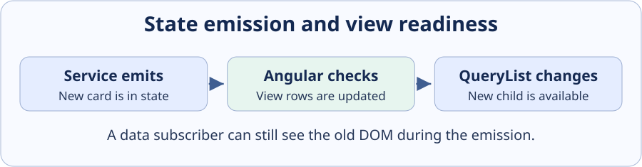
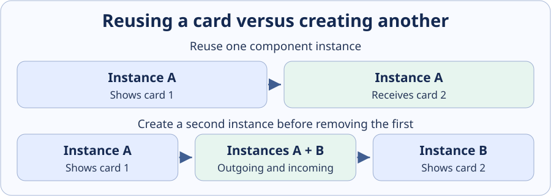

# Angular views and component identity

Adding a card caused the shoebox to compute a transform for a DOM ID that had yet to appear. The journal tried OnPush, `detectChanges()`, `trackBy` and the async pipe while searching for the right moment to run the layout. The deciding question was which event guarantees the elements exist. [Original rebalancing investigation](../archive/development-journal-2019.md?plain=1#L278).



## Read the view when the view is ready

In Angular 7, `ngOnInit` runs after initial inputs are set. `ngAfterViewInit` is where this parent can read its initialized view queries. `@ViewChild` selects one matching item and `@ViewChildren` provides a `QueryList` with a `changes` stream. A template reference such as `#cc` gives the query a local target. The template must actually instantiate that target, which matters under `*ngIf` and `*ngFor`. `ngAfterViewChecked` runs after checks and can run frequently, so using it for every layout pass can be wasteful.

In [3bc2237’s shoebox](https://github.com/nastajus/ng-cue-card/blob/3bc2237/src/app/components/cue-card-shoe-box/cue-card-shoe-box.component.ts#L36), the first layout is explicit because the initial query is already available. Later membership changes trigger layout through the view query:

```ts
this.rebalanceBoxCardPositions(this.ccLoaderService.cueCards);

this.cc.changes.subscribe(t => {
  //subsequent calls to capture *changes* to model of cueCards, especially additions and deletions, but also modifications will trigger this.
  this.rebalanceBoxCardPositions(this.ccLoaderService.cueCards);
})
```

The comment generalizes too far. A text edit that preserves the query’s results need not cause it to emit. That is fine if geometry only depends on which cards are present and their order. Changes to dimensions or viewport can require a separate signal. The [checkout](../../src/app/components/cue-card-shoe-box/cue-card-shoe-box.component.ts) has the view-query subscription commented out. It rebalances on the data emission and dereferences the result of `getElementById` directly. The later journal flags this timing problem again. [Late rebalancing notes](../archive/development-journal-2019.md?plain=1#L1417).

## Views, objects and elements

`trackBy` supplies the key Angular uses to match rows across iterable changes. Stable keys let refreshed objects reuse a view. They do not make rendering happen sooner. Changing the input to a reused card updates the same component instance. Destroying a view, such as by removing it from a container, ends that instance’s lifecycle.



`ElementRef` provides access to a rendered element, and `Renderer2` supplies rendering operations such as setting a style. Neither solves timing. Prefer a template style binding when transforms can be computed directly from model data, then Angular applies the value when it creates the view. Use a view query when the calculation actually needs rendered elements or measurements.

[Angular 7 lifecycle guide source](https://github.com/angular/angular/blob/7.2.16/aio/content/guide/lifecycle-hooks.md) · [Angular 7 QueryList source](https://github.com/angular/angular/blob/7.2.16/packages/core/src/linker/query_list.ts) · [Learning index](../LEARNING.md)
