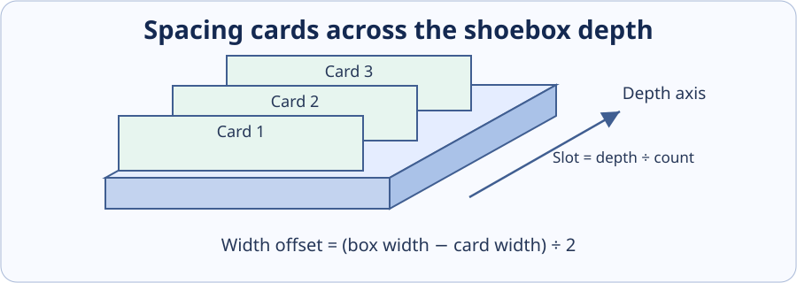

# Shoebox geometry and visual feedback

The shoebox places upright cards inside a box assembled from transformed panels. An isolated cube experiment made the rotations easier to observe before applying them to the box. Perspective changes how depth is projected, while a rotation changes the element’s local axes. With transform functions applied right to left to points, a translation written after the rotations moves along axes that those rotations subsequently turn. Swapping the functions can move a card in a different direction. [Cube experiment](https://github.com/nastajus/ng-cue-card/commit/85cc2bf), [centering investigation](../archive/development-journal-2019.md?plain=1#L55).



## Convert dimensions into placement

The [shoebox component](../../src/app/components/cue-card-shoe-box/cue-card-shoe-box.component.ts) reads compiled front and back offsets and sums them as depth. It computes the horizontal centering offset as half the difference between the box and card widths. For each card it calculates:

```ts
var cardPosition = boxLength / cueCards.length * (i + 1);
```

This is a one-based slot measured across the depth. The helper remaps that distance around the front/back origin and combines it with the card offset in the transform. The final code also has an empirical left offset. The formula keeps spacing proportional to card count, while a floor on spacing or a capacity limit would be needed if overlap at high counts became a usability problem.

SCSS defines dimensions used by both the compiled stylesheet and the component calculations. Keeping one source for both prevented drift when tuning the box. Build-time export introduced a second way to get stale values when the stylesheet rebuilt without the TypeScript module. [Build pipeline](build-tooling.md).

## Read the pointer in the same coordinate system as the card

The [historical interaction](https://github.com/nastajus/ng-cue-card/blob/e978777/src/app/components/cue-card/cue-card.component.ts) found the distance between the pointer and card center with the Pythagorean formula. It used that distance to change height and interpolate RGB channels. The inner card face changes colour, while the outer geometry carries the movement. The archived GIF shows the effect. The equivalent document mouse listener in this checkout is commented out.

Use matching coordinates for the measurement. For example, pair `getBoundingClientRect()` and `clientX/clientY` for viewport coordinates. The original reciprocal distance formula has a singularity at zero and can extrapolate past its intended colour endpoints. A bounded factor such as `Math.max(0, 1 - distance / radius)` is an alternative for a finite radius with predictable endpoints. [Pointer and colour investigation](../archive/development-journal-2019.md?plain=1#L104).

[Learning index](../LEARNING.md)
