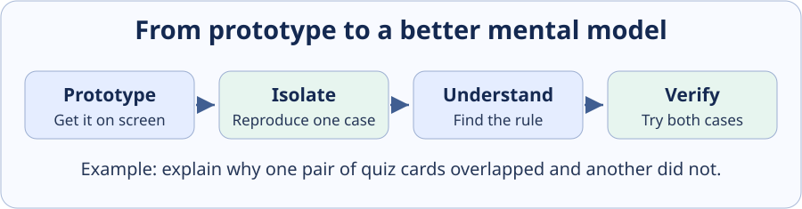

# Engineering methodology

The journal alternates between getting something visible quickly and slowing down when a working recipe fails to explain the next case. The CSS overlap investigation captures the transition: “first i rapidly prototyped with what i didn't understand” and “the **hierchy of elements is just as important to positioning as the styles applied to them.**” The misspelling is in the original. A hard-coded pair of cards proved that overlap could work. Comparing the rendered ancestors exposed why the second case behaved differently. [Overlap notes](../archive/development-journal-2019.md?plain=1#L1210), [overlap commit](https://github.com/nastajus/ng-cue-card/commit/d092d26).

## Choose the smallest experiment that answers the question

- **Geometry.** The test cube isolated coordinates and rotations from the quiz and card model. Try one transform on one face and identify the reference axes before tuning the full layout. [Test cube commit](https://github.com/nastajus/ng-cue-card/commit/85cc2bf).
- **Timing.** Log the incoming data count and the view query count separately. They describe different stages. Trying a new RxJS operator or change detection strategy without a prediction made the search longer. The journal’s concern about using the async pipe softened once the author asked what evidence supported it. [Rebalancing investigation](../archive/development-journal-2019.md?plain=1#L278).
- **Lifecycle and animation.** Log a specific instance on creation, transition completion and destruction. This distinguishes two components legitimately being destroyed from one component’s completion handler being registered twice. Then check the element the trigger actually targets. [Host and completion notes](../archive/development-journal-2019.md?plain=1#L1400).

## Decide what would justify more design work

“I need to make some kind of implementation for my brain to effectively think if it's good or not” appears in the model investigation. That is a good criterion for a spike. Build enough to expose a real boundary, then revisit the decision under concrete requirements. Recognizing a card in an in-memory array is a tactical choice. Knowing whether a card’s identity must survive edits, imports and study sessions is a strategic question about the product. The recovered user stories explain the latter better than debates about how many services to create. [Model-design notes](../archive/development-journal-2019.md?plain=1#L564), [recovered user stories](../archive/development-journal-2019.md#supplement--file-export-and-the-study-workflow).

The same criterion works for libraries and abstractions. The notes explicitly wait for a third use before extracting a CSS lookup helper and weigh how much time an immutable-state library would take to learn. A reasonable stopping point is when another hour of reading is unlikely to change the next implementation decision. Record the uncertainty and what would reopen it. In this project, browser behaviour and refactor regressions were worth recording because the next experiment could measure them.

[Learning index](../LEARNING.md)
