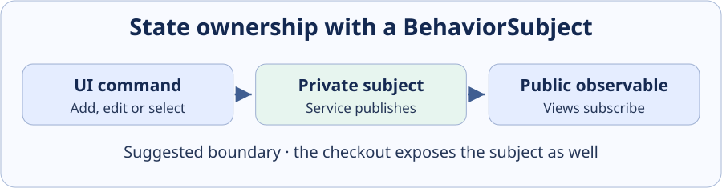

# Reactive programming

Selection began as a getter/setter problem. The editing form needed the current selection as soon as it subscribed and needed to hear subsequent changes. An Angular `EventEmitter` fits component outputs, such as the quiz card announcing a flip. The editor’s ongoing state has different semantics. [Mouse-reactivity investigation](../archive/development-journal-2019.md?plain=1#L104).

## State streams and write ownership

An observable exposes a subscription interface. An observer supplies handlers for next, error and completion. A subject is both a source you can subscribe to and something you can call `next` on. A plain Subject broadcasts future values. A BehaviorSubject starts with a value and gives a live new subscriber the latest value. A ReplaySubject can replay a buffer, and an AsyncSubject emits its final value on completion.

The [2019 loader](../../src/app/services/cue-card-loader.service.ts) exposes a BehaviorSubject-backed observable:

```ts
cueCardsSource: BehaviorSubject<CueCard[]> = new BehaviorSubject<CueCard[]>(this._cueCards);
cueCards$ = this.cueCardsSource.asObservable();
```

The source line above omits the original trailing comment. At this revision the writer is still public. A stronger boundary would make it private, expose only the observable and do writes through named operations. `asObservable()` hides the subject API on that wrapper. Emitted objects remain mutable, so readers can still alter them if the owner shares live references.



## Subscription and completion

The shoebox investigation tried piping the collection into `*ngFor`. The async pipe subscribes, updates the binding and cleans up when the view is destroyed. It cannot make a second, manual data subscription run after the view renders. Use the async pipe for template data and reserve imperative subscriptions for effects with a clear lifetime. The view itself supplies the readiness signal when the effect needs rendered children. [Component lifecycle](component-lifecycle.md).

The teardown investigation initially used RxJS 5-style method syntax. In RxJS 6, import `takeUntil` from `rxjs/operators` and call it inside `pipe`. The notifier emits to end the subscription. Completing the notifier alone does not trigger this behaviour. This example illustrates the pattern:

```ts
private readonly destroyed$ = new Subject<void>();

ngOnInit() {
  fromEvent(document, 'mousemove')
    .pipe(takeUntil(this.destroyed$))
    .subscribe(event => this.updatePointer(event));
}

ngOnDestroy() {
  this.destroyed$.next();
  this.destroyed$.complete();
}
```

Two card instances can legitimately run the same destruction hook. Trace the instance and the subscription before treating a second stack trace as duplicate teardown. The journal traced one call to the list component. [Teardown and pipeable operators](../archive/development-journal-2019.md?plain=1#L335).

`mergeMap` starts an inner subscription per outer value and merges results, which may arrive out of order. `forkJoin` waits for its inputs to complete and combines their last values when each emitted at least once. An ongoing BehaviorSubject generally stays open, so waiting on it via `forkJoin` can leave the caller waiting indefinitely. Neither operator by itself says “these card elements are now in the DOM.” Choose a signal that describes the actual event and then decide how to combine it with current state. [Late timing investigation](../archive/development-journal-2019.md?plain=1#L1453), [RxJS 6.3.3 source](https://github.com/ReactiveX/rxjs/tree/6.3.3/src/internal).

[Learning index](../LEARNING.md)
