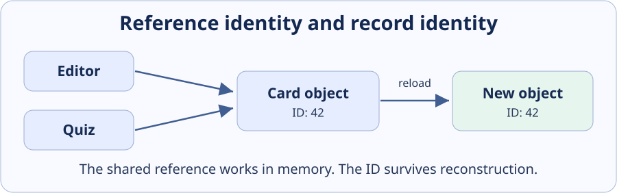
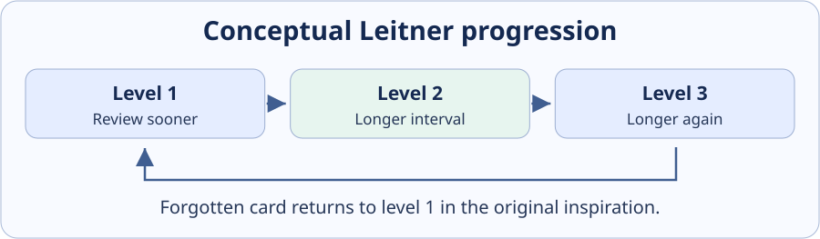

# Domain modelling and state ownership

The first card was little more than a question and an answer. As quizzes, topics and progress entered the design, the journal began asking which copy of a card a service should edit, how other consumers would learn about the change and what should survive closing the app. [Model-design investigation](../archive/development-journal-2019.md?plain=1#L436).

## Identity and change

Two variables can refer to the same JavaScript object. A mutation through either alias is visible through the other. A replacement object has a different reference even when every field matches. The loader uses `includes` and `indexOf`, so callers must pass the actual object in the in-memory collection. Replacing an object during edit means any code holding the old one still sees it. Cloning or deserializing the collection also breaks reference matches.

An **entity** is distinguished by continuity of identity. A card whose history must follow it through edits is a good candidate. A **value object** is distinguished by its value, such as an immutable schedule interval defined by a number and unit. Immutability makes sharing a value safe because an alias cannot change it. An entity can expose mutable state through controlled commands, or keep the same ID across immutable snapshots. Use a stable serialized ID once records must survive reloads or be joined across collections. Two cards with identical wording can still have different review histories.

Domain-driven design starts with the language and rules of the domain. Define what a card, topic, review attempt and due date mean before splitting services around them. Tactical patterns such as entities and value objects help express those rules. Strategic design asks where vocabulary and rules change, for instance between an editing workflow and a scheduling workflow. Cue Card explored that distinction in the journal.

## What the prototype actually owns

- **Implemented.** The [loader](../../src/app/services/cue-card-loader.service.ts) exposes collection and selection observables, edits by replacing an array entry, and publishes the same mutable array. The edit method emits the new active card without updating the private backing field, so a getter caller and a stream subscriber can disagree. Deletion also needs a membership guard because `splice(-1, 1)` removes the last item of a nonempty array.
- **Implemented in part.** [CueCard, StudyTopic, Studiable and QuizzingMoment](../../src/app/models/cue-card.ts) express the richer model, and [DbFakeService](../../src/app/services/db-fake.service.ts) seeds one topic and a quiz subset. `records.slice(1)` gives the quiz a separate array with shared card objects. Replacing a collection entry therefore leaves the quiz holding the previous reference.
- **Explored.** The [Leitner service](../../src/app/services/leitner-system.service.ts) has empty promotion and demotion methods and an uninitialized level array. The quiz has an in-session retry loop. Durable history, date-based scheduling and stable IDs remain design ideas.

One possible boundary is to let the collection own text edits, a quiz session own transient recall outcomes, and a scheduler own due dates and level transitions. A façade could offer a simple UI API across those responsibilities. Dependencies on a shared source are normal when ownership is clear. Mutual dependencies or several services writing the same record make ordering and invariants harder to reason about.

A small RxJS service can encapsulate commands and snapshots with little ceremony. A store such as NgRx offers a more explicit action/reducer/selector structure when cross-feature transitions and debugging warrant it. The decision follows the workflows and their invariants. The research into export and portable histories supplies stronger reasons for IDs and explicit state ownership than the original JavaScript reference concern. [Recovered user stories](../archive/development-journal-2019.md#supplement--file-export-and-the-study-workflow).

[Learning index](../LEARNING.md)
